<!--
  MAINTAINING THIS README
  - This page is an overview: banner, architecture, one card per phase, cleanup.
  - Step-by-step commands live in each phase folder's README.md (manifests/<phase>/README.md).
  - Screenshots live in screenshots/; encode spaces in file names as %20.
  - Header, footer, typing line, badges and icons come from capsule-render.vercel.app,
    readme-typing-svg.demolab.com, shields.io and skillicons.dev.
-->

<a id="top"></a>


<div align="center">

<a href="#the-phases"></a>

<br/><br/>


<br/><br/>

<table>
<tr>
<td align="center" width="170"><h2>7</h2><sub>phases, from Terraform<br/>to RAG</sub></td>
<td align="center" width="170"><h2>250 ms</h2><sub>time to first token<br/>at baseline</sub></td>
<td align="center" width="170"><h2>2.2 req/s</h2><sub>sustained on<br/>one A10G</sub></td>
<td align="center" width="170"><h2>16.4×</h2><sub>faster first token<br/>with LMCache</sub></td>
</tr>
</table>

<sub><code>Ministral-3-8B-Instruct-2512 (BF16)</code> &nbsp;·&nbsp; <code>ap-south-1</code> &nbsp;·&nbsp; <code>genai-workshop</code> &nbsp;·&nbsp; <code>g5.2xlarge</code></sub>

</div>

<br/>

<p align="center"></p>

## The phases

<table>
<tr>
<td width="50%" valign="top">

### 01 · Cluster Setup
<sub><code>terraform/</code></sub>

A single `terraform apply` builds the platform every other phase runs on:

- EKS Auto Mode cluster with a GPU node pool
- VPC and networking
- S3 bucket, plus a job that stages the model weights
- Amazon Managed Prometheus, Grafana and pre-built dashboards
- IAM roles for each workload

We ran it in `ap-south-1` on **g5.2xlarge (NVIDIA A10G, 24 GB)**. The FP8 checkpoint gives garbage output on that GPU, because vLLM falls back to the Marlin kernel, so we serve the **BF16** model. We also gave GPU nodes 200 GiB of disk for the images and weights.

[Step-by-step guide →](./terraform/README.md)

</td>
<td width="50%" valign="top">

### 02 · Serve a Model
<sub><code>manifests/100-vllm</code></sub>

vLLM streams Ministral 8B from S3 onto the GPU and serves it through an OpenAI-compatible API; the first test returned tokens on vLLM 0.21.0. Open WebUI puts a chat interface in front of the model, behind an Application Load Balancer.

For observability, the NVIDIA DCGM Exporter and a vLLM ServiceMonitor feed Prometheus. Grafana then shows GPU health (temperature, power, utilization, memory) next to engine metrics: token counts, time to first token and time per output token. Under load our A10G peaked at 52 °C and 214 W.

<a href="./screenshots/vllm-test.png">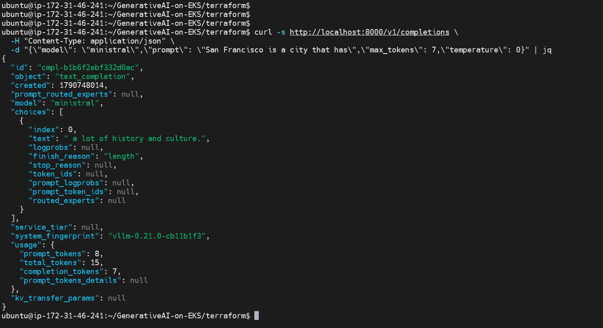</a>
<a href="./screenshots/open-webui.png">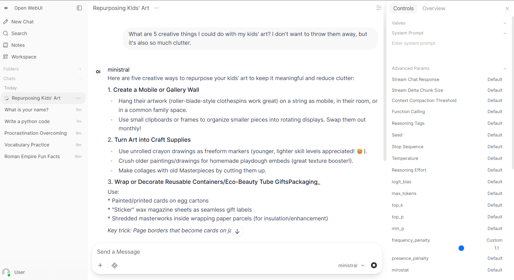</a>
<a href="./screenshots/nvidia-dgcm.png">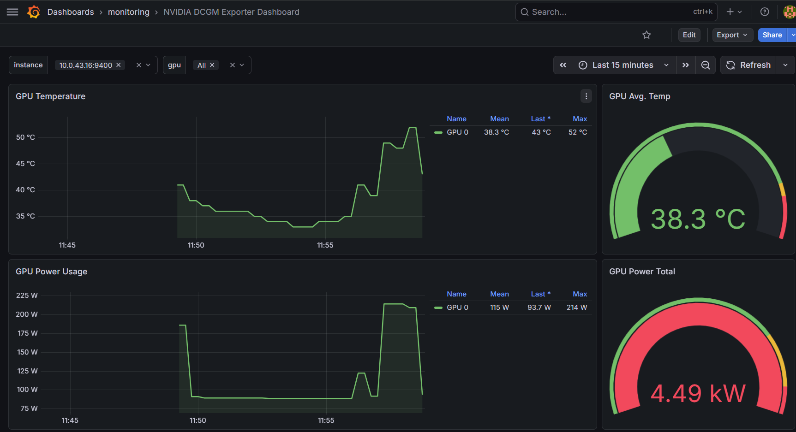</a>
<a href="./screenshots/vllm-metrics.png">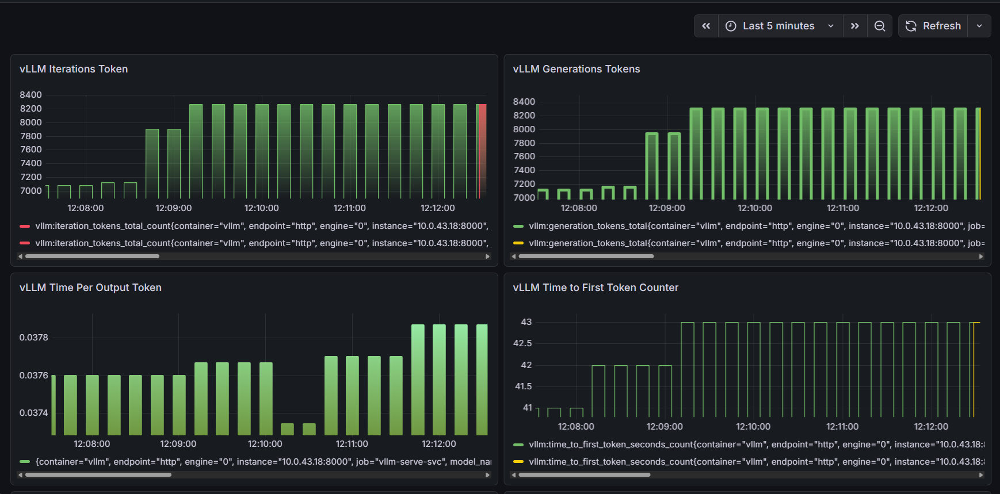</a>

[Step-by-step guide →](./manifests/100-vllm/README.md)

</td>
</tr>
<tr>
<td width="50%" valign="top">

### 03 · Agentic App
<sub><code>manifests/200-strands-agent</code></sub>

A Strands agent, packaged as a FastAPI service and pushed to ECR, uses the vLLM model as its reasoning engine. It has two tools: `current_time`, which uses geopy and TimezoneFinder, and `current_weather`, which calls the Open-Meteo API.

Each question takes two model calls. In the first, the model chooses which tool to call; in the second, it turns the tool's result into a natural reply. A new agent is created for every request, so requests never share state.

<a href="./screenshots/agents-in-action.png">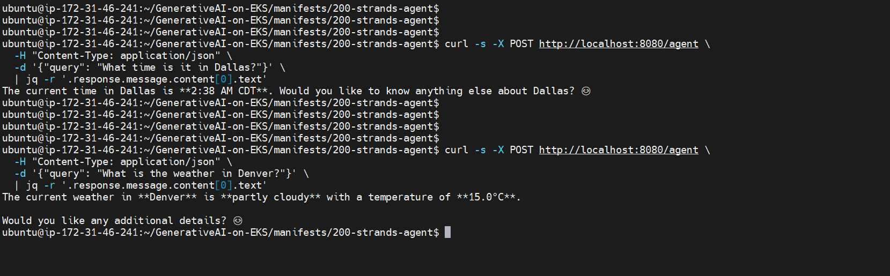</a>

[Step-by-step guide →](./manifests/200-strands-agent/README.md)

</td>
<td width="50%" valign="top">

### 04 · Benchmarking
<sub><code>manifests/300-benchmarking</code></sub>

A Helm-packaged benchmark job loads the model while a dedicated Grafana dashboard tracks the engine.

The **baseline** run (1 req/s, 512-token prompts) completed 60 of 60 requests, with a 250 ms mean time to first token and 45 ms per output token. The **saturation** run stepped from 5 to 10 to 20 req/s. The A10G levelled off at about **2.2 req/s** (roughly 550 output tokens/s). Beyond that, the KV cache stayed near 100%, the waiting queue grew to about 750 requests, preemptions kept climbing, and 22.5% of requests timed out at 20 req/s.

<a href="./screenshots/baseline-scenerio.png">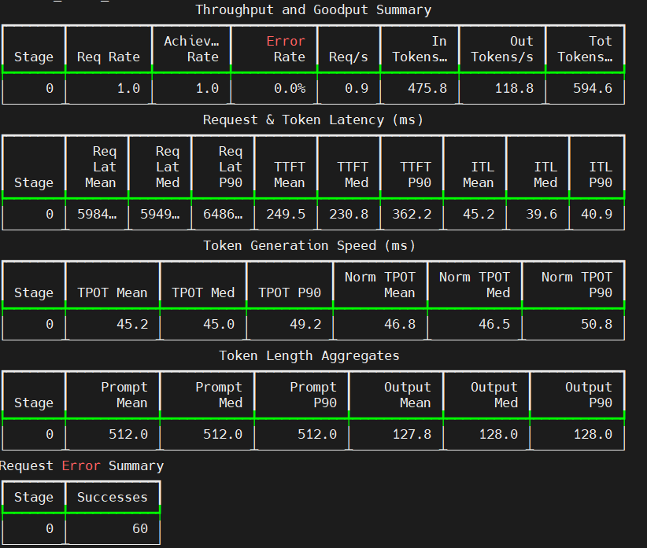</a>
<a href="./screenshots/saturation-scenerio.png">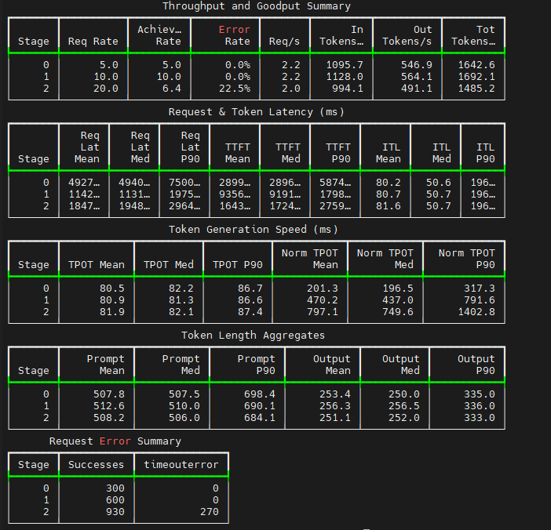</a>
<a href="./screenshots/benchmark-engine-metrics-1.png">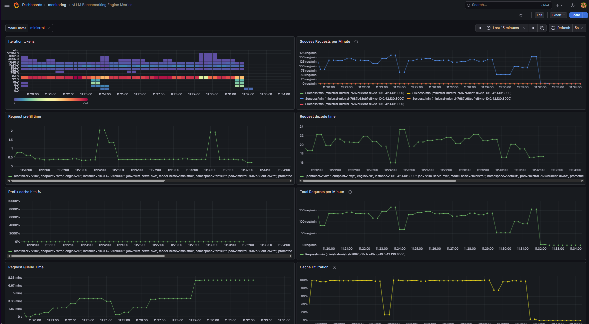</a>
<a href="./screenshots/becnhmarking-engine-metrics-2.png">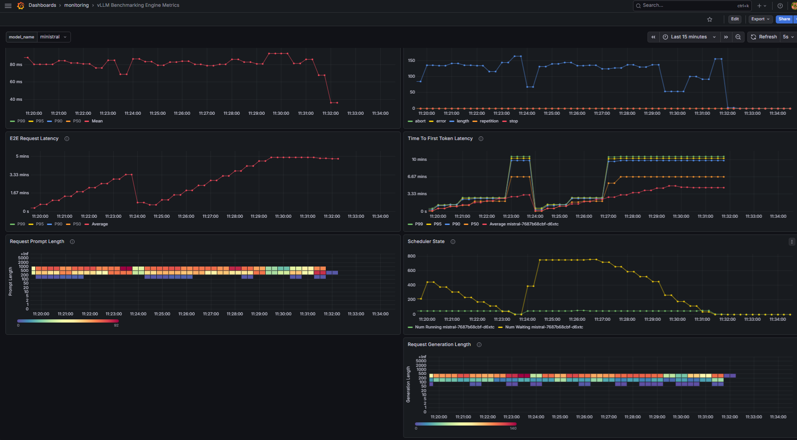</a>
<a href="./screenshots/Screenshot%202026-10-12%20113503.png"></a>
<a href="./screenshots/benchmarking-vllm-metrics.png">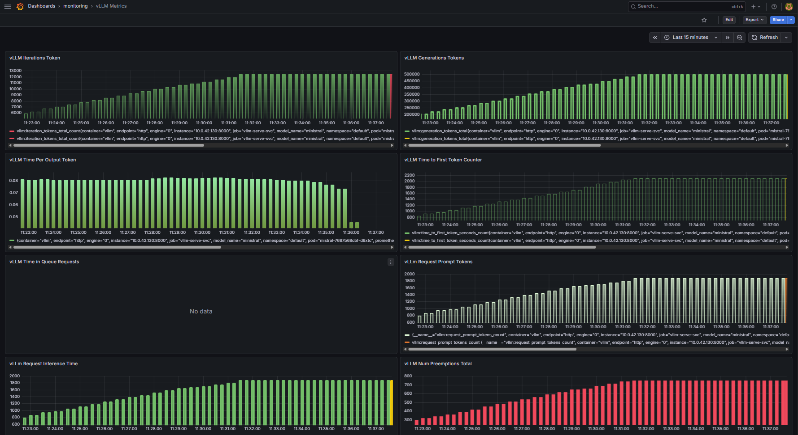</a>

[Step-by-step guide →](./manifests/300-benchmarking/README.md)

</td>
</tr>
<tr>
<td width="50%" valign="top">

### 05 · KV Cache Offloading
<sub><code>manifests/400-lmcache</code></sub>

LMCache keeps a prompt's KV tensors after the first request, so a later request with the same prefix skips most of the prefill work. Each test sends a ~4K-token prompt twice, with 90% of the content shared.

With **L1** (CPU RAM on the same pod), the time to first token fell from 4.46 s to 0.27 s, **16.4× faster**. Adding **L2** (ElastiCache Valkey, shared across pods) took it from 5.78 s to 0.50 s, **11.6× faster**. With L2, a newly started pod can reuse the prefix instead of computing it again.

<a href="./screenshots/LMCache-L1.png">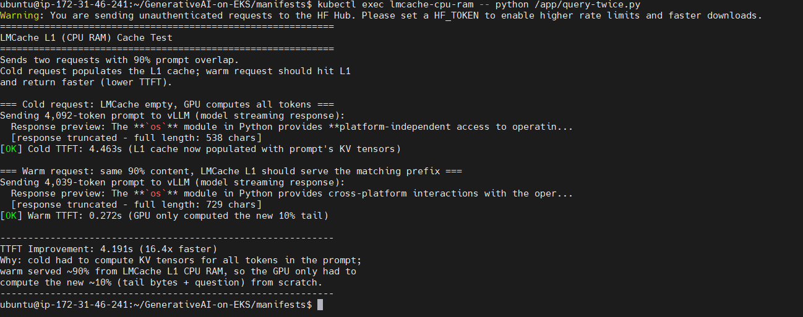</a>
<a href="./screenshots/LMCache%20L1%20%2B%20L2-test.png"></a>

[Step-by-step guide →](./manifests/400-lmcache/README.md)

</td>
<td width="50%" valign="top">

### 06 · Fine-Tuning
<sub><code>manifests/600-finetuning</code></sub>

LoRA fine-tuning teaches Ministral to act as a startup advisor without retraining the full model:

- **Prepare the dataset:** a startup-advisory Q&A set in JSONL
- **Train the adapter:** a Kubernetes Job runs the LoRA training script on the GPU
- **Deploy with LoRA:** vLLM serves the adapter next to the base model
- **Compare results:** the same prompts sent to the base model and to the fine-tuned model

We changed the training to load the BF16 checkpoint directly, instead of dequantizing FP8, so it fits on a single 24 GB A10G rather than a 48 GB L40S.

[Step-by-step guide →](./manifests/600-finetuning/README.md)

</td>
</tr>
<tr>
<td colspan="2" valign="top">

### 07 · RAG
<sub><code>manifests/700-rag</code></sub>

Retrieval-augmented generation grounds the model in our own data. A processing job chunks and embeds a product catalogue into an S3 vector store, a RAG service retrieves the closest matches for each question, and a Gradio app answers the same question twice: once from the model alone and once with the retrieved context. The plain model answers in generalities. The RAG answer names the actual products, such as *PowerBook Pro*, *UltraBook Slim* and *SmartBulb Color*, and shows the source chunks with their similarity scores.

<a href="./screenshots/RAG-test.png">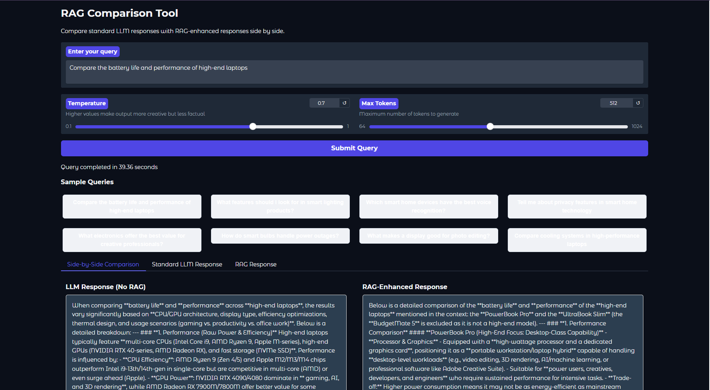</a>
<a href="./screenshots/RAG-test-2.png">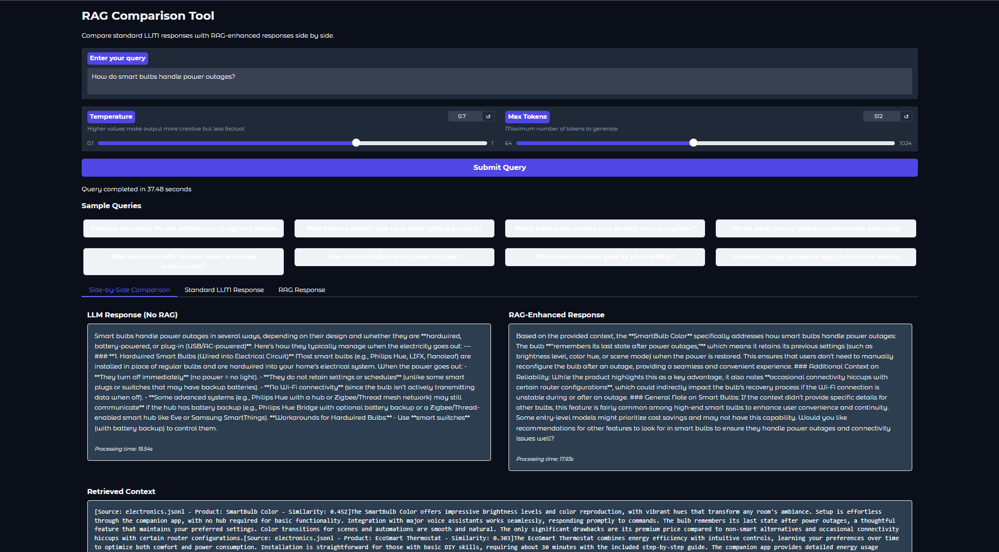</a>

[Step-by-step guide →](./manifests/700-rag/README.md)

</td>
</tr>
</table>

## Cleanup

> [!CAUTION]
> **Leave no GPU running.** g5 nodes are billed by the hour, whether or not you're using them.

<table>
<tr>
<td width="50%" valign="top">

**1 · Tear it all down**

```bash
cd terraform
terraform destroy --auto-approve
```

</td>
<td width="50%" valign="top">

**2 · Confirm it's gone**

```bash
aws eks list-clusters --region ap-south-1
# genai-workshop should no longer be listed
```

</td>
</tr>
</table>

<br/>

<div align="center">

### The journey, in one line

[Cluster Setup](./terraform/README.md) &nbsp;→&nbsp;
[Serve a Model](./manifests/100-vllm/README.md) &nbsp;→&nbsp;
[Agentic App](./manifests/200-strands-agent/README.md) &nbsp;→&nbsp;
[Benchmarking](./manifests/300-benchmarking/README.md) &nbsp;→&nbsp;
[KV Cache Offloading](./manifests/400-lmcache/README.md) &nbsp;→&nbsp;
[Fine-Tuning](./manifests/600-finetuning/README.md) &nbsp;→&nbsp;
[RAG](./manifests/700-rag/README.md)

<br/>

<sub>BUILT WITH</sub>


<br/>

<sub>plus <a href="https://docs.vllm.ai">vLLM</a> · <a href="https://strandsagents.com">Strands Agents</a> · <a href="https://docs.lmcache.ai">LMCache</a> · <a href="https://docs.openwebui.com">Open WebUI</a> · <a href="https://github.com/NVIDIA/dcgm-exporter">NVIDIA DCGM</a></sub>

</div>

<br/>


<p align="center">
<a href="#top"><b>Back to top ↑</b></a> &nbsp;·&nbsp;
<a href="https://catalog.workshops.aws/genai-on-eks/en-US">Workshop</a> &nbsp;·&nbsp;
<a href="CONTRIBUTING.md#security-issue-notifications">Security</a> &nbsp;·&nbsp;
<a href="LICENSE">MIT-0 License</a>
</p>
